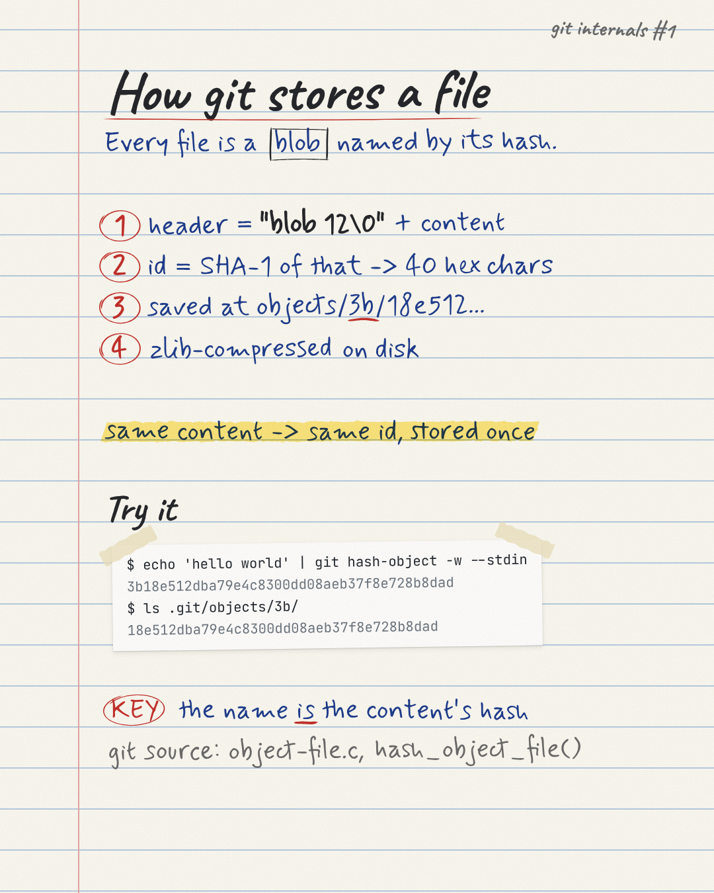
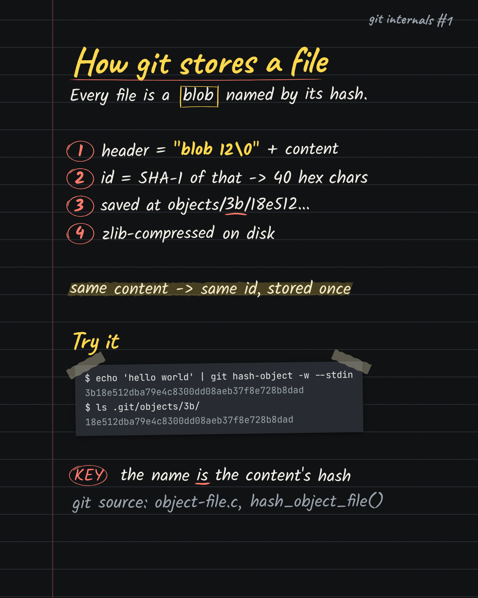
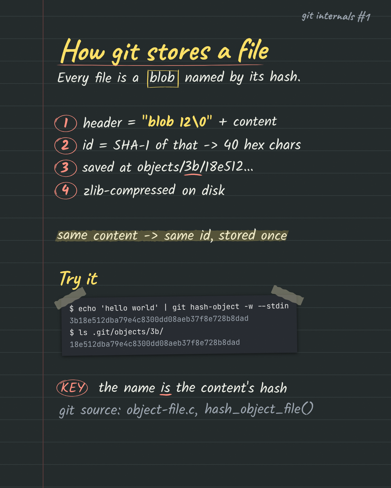
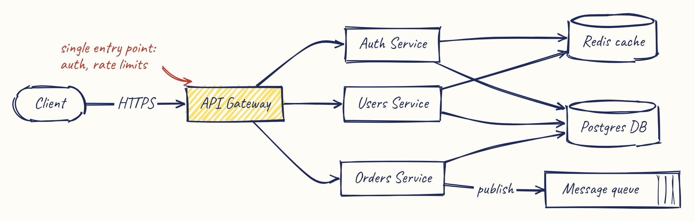

# handinked

Turn a codebase or a hard topic into handwritten study notes with hand-drawn diagrams.
Every claim about code points at a real file and line, and a script checks it before
the page is drawn.

**Status:** early work. A first working version of the skill is in `skills/handinked/`
(renderer, three themes, five diagram kinds, lint, citation check, an experimental
personal mode and interview-prep rules). Not packaged or released yet.

  
  
  

## What it will do

- Notebook pages with handwriting, two or three inks, highlighter and margin notes
- Hand-drawn diagrams that are laid out by code, so labels and boxes never collide
- Codebase mode: pins a commit, traces one real request path, cites `file:line`,
  and checks every citation
- Topic mode: concept explainers, paper summaries, one-page cheat sheets
- Three themes: notebook, night and chalkboard
- PNG pages for sharing, a PDF, and an offline HTML file
- Free and local: no image model, no paid API

## License

MIT. Bundled fonts use the SIL Open Font License, with their licence files kept.
